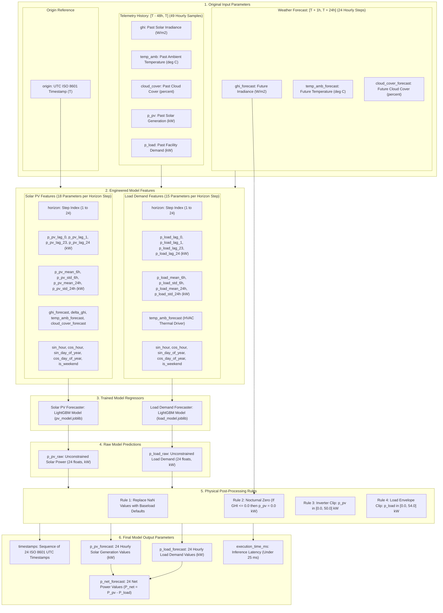
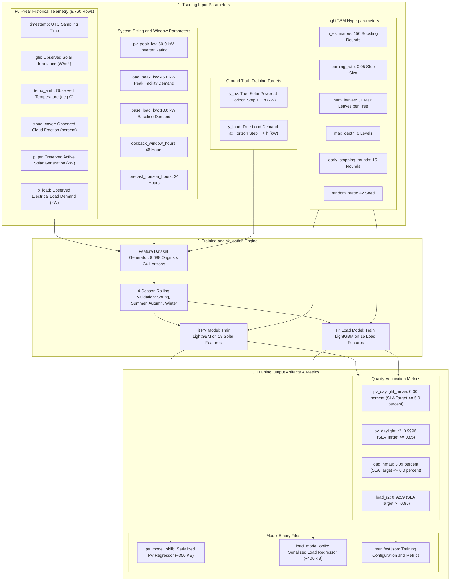

# Helios Forecasting Models: Parameter-Level Input and Output Flowcharts

This document describes all original parameters for the Helios machine learning models.
The language follows the ASD-STE100 specification.
All sentences are short, active, and direct.

---

## 1. Inference / Forecasting Parameter Flowchart

This flowchart shows all input parameters, feature parameters, models, and output parameters.

---

## 2. Model Training Parameter Flowchart

This flowchart shows all input parameters, hyperparameters, targets, and output artifacts for the training phase.

---

## 3. Original Parameter Reference Tables

### 3.1 Inference Input Parameters

| Parameter Name | Data Type | Engineering Unit | Physical Range | Description |
| :--- | :--- | :--- | :--- | :--- |
| `origin` | String / Datetime | UTC ISO 8601 | Whole hour | Reference timestamp $T$ anchoring the forecast. |
| `ghi` (history) | Float Array | W/m2 | $\ge 0.0$ | Observed solar irradiance from pyranometer ($[T-48\text{h}, T]$). |
| `temp_amb` (history) | Float Array | deg C | $[-20.0, 55.0]$ | Observed dry-bulb ambient temperature ($[T-48\text{h}, T]$). |
| `cloud_cover` (history) | Float Array | percent | $[0.0, 100.0]$ | Observed cloud fraction percentage ($[T-48\text{h}, T]$). |
| `p_pv` (history) | Float Array | kW | $[0.0, 50.0]$ | Observed solar PV inverter active power ($[T-48\text{h}, T]$). |
| `p_load` (history) | Float Array | kW | $[0.0, 54.0]$ | Observed facility load demand power ($[T-48\text{h}, T]$). |
| `ghi_forecast` | Float Array | W/m2 | $\ge 0.0$ | Forecasted solar irradiance for 24 future steps ($[T+1\text{h}, T+24\text{h}]$). |
| `temp_amb_forecast` | Float Array | deg C | $[-20.0, 55.0]$ | Forecasted ambient temperature for 24 future steps ($[T+1\text{h}, T+24\text{h}]$). |
| `cloud_cover_forecast` | Float Array | percent | $[0.0, 100.0]$ | Forecasted cloud fraction for 24 future steps ($[T+1\text{h}, T+24\text{h}]$). |

---

### 3.2 Exact Model Input Feature Parameters

These 18 parameters enter the Solar PV model, and 15 parameters enter the Load model:

| Parameter | Used by PV Model? | Used by Load Model? | Parameter Definition |
| :--- | :---: | :---: | :--- |
| `horizon` | Yes | Yes | Integer step index $h \in [1, 24]$. |
| `p_pv_lag_0` | Yes | No | Solar power observed at origin timestamp $T$. |
| `p_pv_lag_1` | Yes | No | Solar power observed at timestamp $T - 1\text{h}$. |
| `p_pv_lag_23` | Yes | No | Solar power observed at timestamp $T - 23\text{h}$. |
| `p_pv_lag_24` | Yes | No | Solar power observed at timestamp $T - 24\text{h}$ (yesterday). |
| `p_pv_mean_6h` | Yes | No | Rolling average solar power over window $[T - 6\text{h}, T]$. |
| `p_pv_std_6h` | Yes | No | Rolling standard deviation of solar power over $[T - 6\text{h}, T]$. |
| `p_pv_mean_24h` | Yes | No | Rolling average solar power over window $[T - 24\text{h}, T]$. |
| `p_pv_std_24h` | Yes | No | Rolling standard deviation of solar power over $[T - 24\text{h}, T]$. |
| `p_load_lag_0` | No | Yes | Facility load observed at origin timestamp $T$. |
| `p_load_lag_1` | No | Yes | Facility load observed at timestamp $T - 1\text{h}$. |
| `p_load_lag_23` | No | Yes | Facility load observed at timestamp $T - 23\text{h}$. |
| `p_load_lag_24` | No | Yes | Facility load observed at timestamp $T - 24\text{h}$ (yesterday). |
| `p_load_mean_6h` | No | Yes | Rolling average load demand over window $[T - 6\text{h}, T]$. |
| `p_load_std_6h` | No | Yes | Rolling standard deviation of load demand over $[T - 6\text{h}, T]$. |
| `p_load_mean_24h`| No | Yes | Rolling average load demand over window $[T - 24\text{h}, T]$. |
| `p_load_std_24h` | No | Yes | Rolling standard deviation of load demand over $[T - 24\text{h}, T]$. |
| `ghi_forecast` | Yes | No | Future irradiance at step $T+h$. |
| `delta_ghi` | Yes | No | Irradiance rate of change: $GHI(T+h) - GHI(T+h-1)$. |
| `temp_amb_forecast`| Yes | Yes | Future ambient temperature at step $T+h$. |
| `cloud_cover_forecast`| Yes | No | Future cloud coverage percentage at step $T+h$. |
| `sin_hour` | Yes | Yes | Cyclical diurnal encoding: $\sin(2\pi \cdot \text{hour} / 24)$. |
| `cos_hour` | Yes | Yes | Cyclical diurnal encoding: $\cos(2\pi \cdot \text{hour} / 24)$. |
| `sin_day_of_year` | Yes | Yes | Seasonal encoding: $\sin(2\pi \cdot \text{day} / 365.25)$. |
| `cos_day_of_year` | Yes | Yes | Seasonal encoding: $\cos(2\pi \cdot \text{day} / 365.25)$. |
| `is_weekend` | Yes | Yes | Binary indicator (1.0 for weekend; 0.0 for weekday). |

---

### 3.3 Model Output Parameters

| Output Parameter | Data Type | Physical Range | Engineering Unit | Destination / Consumer |
| :--- | :--- | :--- | :--- | :--- |
| `p_pv_raw` | Array of 24 floats | Unconstrained | kW | Boundary Enforcer input. |
| `p_load_raw` | Array of 24 floats | Unconstrained | kW | Boundary Enforcer input. |
| `timestamps` | Array of 24 strings | UTC ISO 8601 | - | REST API client & UI charts. |
| `p_pv_forecast` | Array of 24 floats | $[0.0, 50.0]$ | kW | Battery dispatch optimizer & UI charts. Zero when $GHI \le 0$. |
| `p_load_forecast`| Array of 24 floats | $[0.0, 54.0]$ | kW | Battery dispatch optimizer & UI charts. |
| `p_net_forecast` | Array of 24 floats | $[-54.0, 50.0]$| kW | Battery dispatch controller ($P_{\text{net}} = P_{\text{pv}} - P_{\text{load}}$). |
| `execution_time_ms`| Float | Typically 14.2 ms | Milliseconds | Operational health monitoring (SLA $< 25$ ms). |
