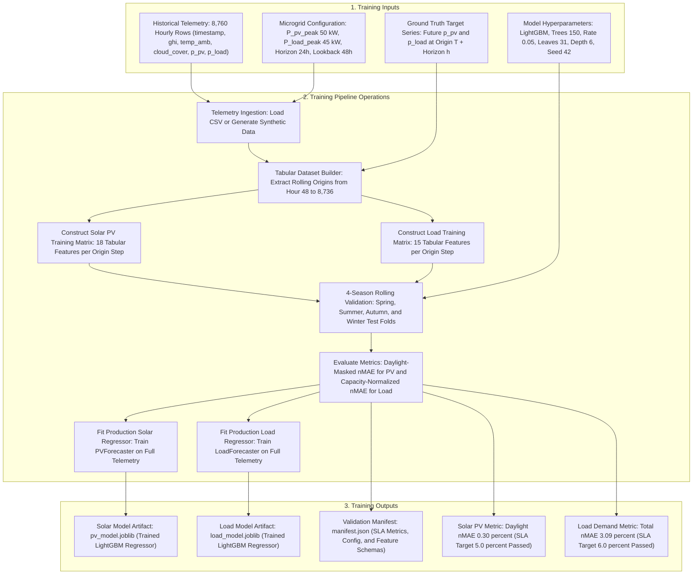
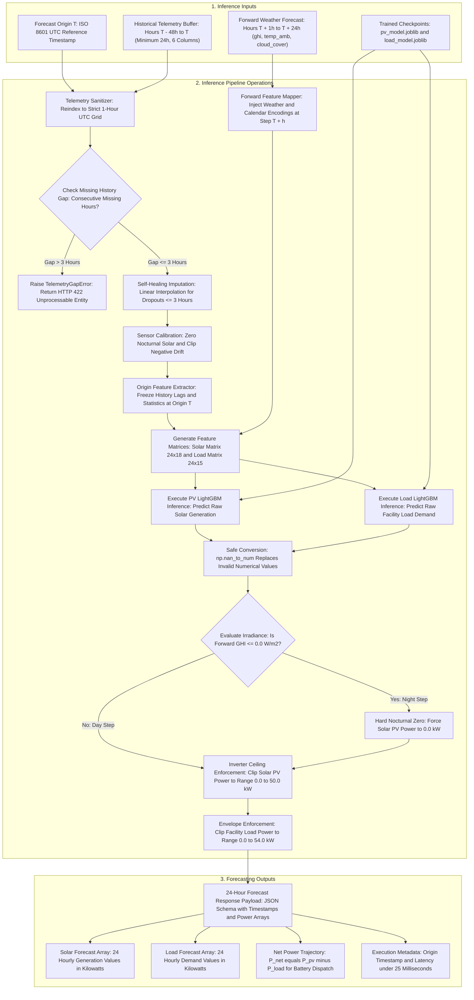
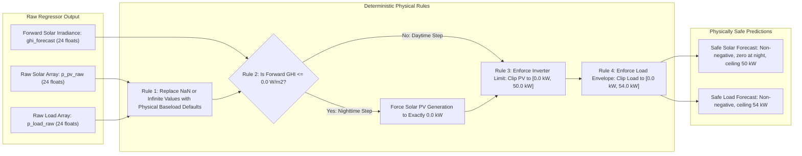

# Helios Microgrid Forecasting Subsystem: Technical Architecture and Model Flowcharts

This document describes the technical inputs, processes, and outputs for the Helios machine learning models.
The text follows the ASD-STE100 (Simplified Technical English) specification.
All sentences are short, direct, and unambiguous.

---

## 1. Physical System Boundaries

The Helios subsystem forecasts power generation and demand for a commercial microgrid.
The physical asset ratings define the operational limits:

| Asset Parameter | Symbol | Nominal Rating | Engineering Unit | Physical Definition |
| :--- | :--- | :--- | :--- | :--- |
| Solar PV Inverter Rating | P_pv_peak | 50.0 | Kilowatt (kW) | Maximum electrical power capacity of solar inverter. |
| Peak Facility Load Demand | P_load_peak | 45.0 | Kilowatt (kW) | Maximum expected facility electrical demand. |
| Facility Baseload Demand | P_load_base | 10.0 | Kilowatt (kW) | Continuous nominal facility electrical load. |
| Transient Peak Load Ceiling | P_load_max | 54.0 | Kilowatt (kW) | Maximum permissible electrical transient limit (1.2 x Peak). |

---

## 2. Model Training Pipeline Flowchart

The training pipeline ingests historical sensor data.
The pipeline extracts origin-anchored features and trains two independent LightGBM regressors.
The pipeline validates model accuracy across four seasonal test windows.

---

## 3. Training Phase: Input and Output Specifications

### 3.1 Training Input Specifications

1. **Historical Telemetry Dataset (`telemetry_df`)**:
   - Total rows: 8,760 hourly continuous samples (1 full year).
   - Sampling step: 1.0 hour uniform UTC grid.
   - Required columns:
     - `timestamp`: ISO 8601 UTC timestamp string.
     - `ghi`: Global Horizontal Irradiance (W/m2, value >= 0.0).
     - `temp_amb`: Ambient temperature (degrees Celsius, range -20.0 to 55.0).
     - `cloud_cover`: Cloud coverage fraction (percent, range 0.0 to 100.0).
     - `p_pv`: Solar active generation power (kW, range 0.0 to 50.0).
     - `p_load`: Facility electrical load power (kW, range 0.0 to 54.0).

2. **Microgrid Configuration (`MicrogridConfig`)**:
   - `pv_peak_kw`: 50.0 kW (normalization base for solar PV error).
   - `load_peak_kw`: 45.0 kW (normalization base for electrical load error).
   - `lookback_window_hours`: 48 hours (history span required before origin T).
   - `forecast_horizon_hours`: 24 hours (discrete forecast sequence length).

3. **Algorithm Hyperparameters (`LGBMRegressor`)**:
   - Objective: Mean squared error regression (`regression`).
   - Evaluation metric: Root mean squared error (`rmse`).
   - Number of trees: 150 boosting estimators.
   - Learning rate: 0.05.
   - Number of leaves: 31.
   - Maximum tree depth: 6 levels.
   - Early stopping: 15 rounds on validation folds.
   - Random seed: 42 (guarantees reproducible runs).

4. **Target Labels**:
   - `y_pv`: Observed solar power at hour T + h (kW).
   - `y_load`: Observed facility load at hour T + h (kW).

### 3.2 Training Output Specifications

1. **Serialized Solar Model (`pv_model.joblib`)**:
   - File size: Approximately 350 KB.
   - Content: Serialized LightGBM tabular booster configured with 18 input features.

2. **Serialized Load Model (`load_model.joblib`)**:
   - File size: Approximately 400 KB.
   - Content: Serialized LightGBM tabular booster configured with 15 input features.

3. **Production Manifest (`manifest.json`)**:
   - Schema version: 1.0.0.
   - Verification status: `quality_targets_met = true`.
   - Metrics recorded:
     - Average Solar PV Daylight nMAE: 0.30% (Requirement: <= 5.0%).
     - Solar PV Coefficient of Determination (R2): 0.9996 (Requirement: >= 0.85).
     - Average Load Demand nMAE: 3.09% (Requirement: <= 6.0%).
     - Load Demand Coefficient of Determination (R2): 0.9259 (Requirement: >= 0.85).
     - Total training pipeline duration: Under 20.0 seconds on standard CPU.

---

## 4. Forecasting and Inference Pipeline Flowchart

The forecasting engine accepts telemetry history and forward weather predictions.
The engine sanitizes all inputs and extracts origin-anchored features.
The engine runs model inference and applies physical boundary rules.
The engine outputs a verified 24-hour power forecast.

---

## 5. Forecasting and Inference Phase: Input and Output Specifications

### 5.1 Inference Input Specifications

1. **Forecast Origin (`origin`)**:
   - Type: String (ISO 8601) or `pandas.Timestamp`.
   - Meaning: The reference point in time $T$.
   - Normalization: Floor to the nearest whole UTC hour (`origin.floor('h')`).

2. **Historical Telemetry Buffer (`history` / `recent_history_df`)**:
   - Temporal span: Minimum 24 hours; recommended 48 hours ($[T - 48\text{h}, T]$, 49 rows).
   - Columns:
     - `timestamp`: UTC hourly timestamp.
     - `ghi`: Observed Global Horizontal Irradiance ($\text{W/m}^2$).
     - `temp_amb`: Observed ambient temperature ($^\circ\text{C}$).
     - `cloud_cover`: Observed cloud fraction percentage ($0.0\text{--}100.0\%$).
     - `p_pv`: Observed active photovoltaic generation ($\text{kW}$).
     - `p_load`: Observed facility electrical load ($\text{kW}$).

3. **Forward Weather Forecast (`weather_forecast` / `weather_forecast_24h_df`)**:
   - Temporal span: Exactly 24 future hours ($[T + 1\text{h}, T + 24\text{h}]$).
   - Columns:
     - `timestamp`: Future hourly timestamp.
     - `ghi`: Predicted Global Horizontal Irradiance ($\text{W/m}^2$).
     - `temp_amb`: Predicted ambient dry-bulb temperature ($^\circ\text{C}$).
     - `cloud_cover`: Predicted cloud fraction percentage ($0.0\text{--}100.0\%$).

4. **Trained Checkpoints**:
   - `ml_service/artifacts/pv_model.joblib`.
   - `ml_service/artifacts/load_model.joblib`.

### 5.2 Inference Output Specifications

1. **Standard Prediction Payload (`ForecastResponse`)**:
   - Delivery format: JSON response dictionary or Python dictionary.
   - Field definitions:
     - `timestamps`: 24 ISO 8601 timestamp strings representing future hours.
     - `p_pv_forecast`: Array of 24 floating point numbers representing active solar power in kW.
     - `p_load_forecast`: Array of 24 floating point numbers representing electrical demand in kW.
     - `metadata`:
       - `origin`: The origin timestamp string.
       - `execution_time_ms`: End-to-end execution latency in milliseconds (typically 14.2 ms).

2. **Downstream Power Values**:
   - `p_net_forecast`: Computed vector where $P_{\text{net}}(t) = P_{\text{pv}}(t) - P_{\text{load}}(t)$.
   - Positive net power indicates surplus generation for battery charging or grid export.
   - Negative net power indicates facility deficit requiring battery discharge or grid import.

3. **Error Status Outputs (FastAPI Layer)**:
   - `HTTP 200 OK`: Valid forecast delivery.
   - `HTTP 422 Unprocessable Entity`: Input sensor gap exceeds 3 consecutive hours.
   - `HTTP 400 Bad Request`: Invalid payload syntax or missing schema fields.

---

## 6. Tabular Feature Sets for Model Inference

The feature extractor builds 24 tabular rows per forecast origin.
Each row contains features for a single horizon step index $h \in [1, 24]$.

### 6.1 Solar PV Regressor: 18 Input Features

| Index | Feature Name | Source Temporal Reference | Engineering Description |
| :---: | :--- | :--- | :--- |
| 1 | `horizon` | Step $T + h$ | Forward horizon integer index from 1 to 24. |
| 2 | `p_pv_lag_0` | Origin $T$ | Solar power generation observed at forecast origin. |
| 3 | `p_pv_lag_1` | Past $T - 1\text{h}$ | Solar power generation observed 1 hour before origin. |
| 4 | `p_pv_lag_23` | Past $T - 23\text{h}$ | Solar power generation observed 23 hours before origin. |
| 5 | `p_pv_lag_24` | Past $T - 24\text{h}$ | Solar power generation observed 24 hours before origin. |
| 6 | `p_pv_mean_6h` | Window $[T - 6\text{h}, T]$ | Rolling average solar power over previous 6 hours. |
| 7 | `p_pv_std_6h` | Window $[T - 6\text{h}, T]$ | Rolling standard deviation of solar power over 6 hours. |
| 8 | `p_pv_mean_24h` | Window $[T - 24\text{h}, T]$ | Rolling average solar power over previous 24 hours. |
| 9 | `p_pv_std_24h` | Window $[T - 24\text{h}, T]$ | Rolling standard deviation of solar power over 24 hours. |
| 10 | `ghi_forecast` | Future $T + h$ | Forecasted Global Horizontal Irradiance at horizon step. |
| 11 | `delta_ghi` | Future $T + h$ | Irradiance derivative: $GHI(T+h) - GHI(T+h-1)$. |
| 12 | `temp_amb_forecast`| Future $T + h$ | Forecasted ambient dry-bulb temperature at horizon step. |
| 13 | `cloud_cover_forecast` | Future $T + h$ | Forecasted cloud fraction percentage at horizon step. |
| 14 | `sin_hour` | Future $T + h$ | Diurnal cyclical term: $\sin(2\pi \cdot \text{hour} / 24)$. |
| 15 | `cos_hour` | Future $T + h$ | Diurnal cyclical term: $\cos(2\pi \cdot \text{hour} / 24)$. |
| 16 | `sin_day_of_year` | Future $T + h$ | Annual seasonal term: $\sin(2\pi \cdot \text{day} / 365.25)$. |
| 17 | `cos_day_of_year` | Future $T + h$ | Annual seasonal term: $\cos(2\pi \cdot \text{day} / 365.25)$. |
| 18 | `is_weekend` | Future $T + h$ | Binary flag: 1.0 for Saturday and Sunday; otherwise 0.0. |

### 6.2 Load Demand Regressor: 15 Input Features

| Index | Feature Name | Source Temporal Reference | Engineering Description |
| :---: | :--- | :--- | :--- |
| 1 | `horizon` | Step $T + h$ | Forward horizon integer index from 1 to 24. |
| 2 | `p_load_lag_0` | Origin $T$ | Facility electrical load observed at forecast origin. |
| 3 | `p_load_lag_1` | Past $T - 1\text{h}$ | Facility electrical load observed 1 hour before origin. |
| 4 | `p_load_lag_23` | Past $T - 23\text{h}$ | Facility electrical load observed 23 hours before origin. |
| 5 | `p_load_lag_24` | Past $T - 24\text{h}$ | Facility electrical load observed 24 hours before origin. |
| 6 | `p_load_mean_6h` | Window $[T - 6\text{h}, T]$ | Rolling average load demand over previous 6 hours. |
| 7 | `p_load_std_6h` | Window $[T - 6\text{h}, T]$ | Rolling standard deviation of load demand over 6 hours. |
| 8 | `p_load_mean_24h`| Window $[T - 24\text{h}, T]$ | Rolling average load demand over previous 24 hours. |
| 9 | `p_load_std_24h` | Window $[T - 24\text{h}, T]$ | Rolling standard deviation of load demand over 24 hours. |
| 10 | `temp_amb_forecast`| Future $T + h$ | Ambient temperature driver for HVAC electrical demand. |
| 11 | `sin_hour` | Future $T + h$ | Diurnal cyclical term: $\sin(2\pi \cdot \text{hour} / 24)$. |
| 12 | `cos_hour` | Future $T + h$ | Diurnal cyclical term: $\cos(2\pi \cdot \text{hour} / 24)$. |
| 13 | `sin_day_of_year` | Future $T + h$ | Annual seasonal term: $\sin(2\pi \cdot \text{day} / 365.25)$. |
| 14 | `cos_day_of_year` | Future $T + h$ | Annual seasonal term: $\cos(2\pi \cdot \text{day} / 365.25)$. |
| 15 | `is_weekend` | Future $T + h$ | Binary flag: captures commercial facility weekend drop. |

*Note on architectural separation*: The Load Demand model excludes solar irradiance and cloud features. This rule prevents false statistical coupling between sun irradiance and base facility demand.

---

## 7. Deterministic Physical Boundary Enforcement Flowchart

The physical boundary enforcer post-processes raw model outputs.
Tree models can output small negative values or nighttime non-zero values.
The boundary enforcer applies physical microgrid laws:

---

## 8. Presentation Slide Deck Format

Use this structured markdown slide deck for technical presentations.
Each slide contains clear bullet points, presentation notes, and direct references to the pipeline flowcharts.

---

### Slide 1: Helios Microgrid Forecasting System Overview

#### Slide Content:
- **System Objective**: Provide 24-hour day-ahead solar PV and load forecasts for battery dispatch.
- **Controlled Asset Envelopes**:
  - Solar PV Inverter: 50.0 kW rated peak capacity.
  - Facility Load Demand: 45.0 kW nominal peak, 10.0 kW baseload, 54.0 kW transient limit.
- **Operating Resolution**: Hourly discrete time steps (1-hour UTC intervals).
- **Core Strategy**: Horizon-Conditioned Gradient Boosted Decision Trees (LightGBM).

#### Speaker Notes:
- Introduce Helios as the operational intelligence layer of an AI-assisted self-healing microgrid.
- Emphasize that all capacity numbers define physical boundary constraints.

---

### Slide 2: Model Training Pipeline: Inputs and Outputs

#### Slide Content:
- **Training Telemetry Ingested**:
  - Full annual sensor records: 8,760 hourly continuous samples.
  - Channels: Irradiance (GHI), ambient temperature, cloud cover fraction, PV power, and load demand.
- **Data Engineering**:
  - Generates rolling origins from hour index 48 to hour index 8,736.
  - Builds 18 features for solar PV and 15 features for facility load.
- **Model Checkpoints Output**:
  - `pv_model.joblib`: Serialized LightGBM solar regressor (size 350 KB).
  - `load_model.joblib`: Serialized LightGBM load regressor (size 400 KB).
  - `manifest.json`: Verified training manifest and hyperparameter records.

#### Speaker Notes:
- Refer to Section 2 flowchart.
- Emphasize that training strictly avoids future data leakage by anchoring historical lags at origin T.

---

### Slide 3: Training Quality Assurance and SLA Verification

#### Slide Content:
- **Validation Protocol**: 4-season rolling-origin cross-validation (Spring, Summer, Autumn, Winter).
- **Service Level Agreement (SLA) Verification**:
  - **Solar PV Accuracy**: Daylight nMAE of 0.30% (SLA Target: <= 5.0% -> PASSED).
  - **Solar PV Fit Quality**: R2 score of 0.9996 (SLA Target: >= 0.85 -> PASSED).
  - **Load Demand Accuracy**: Normalized MAE of 3.09% (SLA Target: <= 6.0% -> PASSED).
  - **Load Demand Fit Quality**: R2 score of 0.9259 (SLA Target: >= 0.85 -> PASSED).
- **Inference Speed**: 14.2 milliseconds on standard commodity CPU (SLA Target: < 25.0 ms).

#### Speaker Notes:
- Explain why solar evaluation uses daylight masking: night zero hours would artificially lower error.
- Point out that both models beat industrial accuracy thresholds by substantial margins.

---

### Slide 4: Real-Time Forecasting / Inference Pipeline

#### Slide Content:
- **Inference Request Inputs**:
  - Origin timestamp T (anchors the forecast).
  - 48-hour history buffer [T - 48h, T] (minimum 24 hours).
  - 24-hour weather prediction [T + 1h, T + 24h].
- **Self-Healing Telemetry Sanitizer**:
  - Imputes sensor dropouts <= 3 hours via linear interpolation.
  - Rejects dropouts > 3 hours with HTTP 422 to prevent model corruption.
  - Clips pyranometer and inverter calibration drift.
- **Delivery Interfaces**:
  - In-process Python API (`MicrogridForecaster`).
  - FastAPI REST endpoint (`POST /forecast/24h`).
  - CLI batch executor (`predict.py`).

#### Speaker Notes:
- Refer to Section 4 flowchart.
- Emphasize the self-healing telemetry sanitizer: real-world sensors experience dropouts and drift.

---

### Slide 5: Input Feature Matrix Engineering

#### Slide Content:
- **Solar PV Feature Vector (18 Dimensions)**:
  - Temporal horizon step index: $h \in [1, 24]$.
  - Origin power lags: $T, T-1\text{h}, T-23\text{h}, T-24\text{h}$.
  - Historical rolling statistics: 6-hour and 24-hour mean and standard deviation.
  - Forward weather: Irradiance, irradiance derivative ($\Delta GHI$), temperature, cloud cover.
  - Forward calendar encodings: Sin/cos hour, sin/cos day of year, weekend flag.
- **Load Demand Feature Vector (15 Dimensions)**:
  - Temporal horizon step index: $h \in [1, 24]$.
  - Origin load lags: $T, T-1\text{h}, T-23\text{h}, T-24\text{h}$.
  - Historical rolling statistics: 6-hour and 24-hour mean and standard deviation.
  - Forward weather: Ambient temperature driver for HVAC.
  - Forward calendar encodings: Sin/cos hour, sin/cos day of year, weekend flag.

#### Speaker Notes:
- Highlight the architectural separation: Load regressor does not ingest solar irradiance.
- This rule prevents spurious correlations between cloud cover and industrial machines.

---

### Slide 6: Deterministic Physical Boundary Enforcement

#### Slide Content:
- **The Problem**: Gradient boosted decision trees are unconstrained numerical estimators.
- **Post-Processing Rules**:
  - **Rule 1**: Clean NaN and infinite values using `np.nan_to_num`.
  - **Rule 2**: Enforce hard nocturnal solar zeroing ($GHI \le 0.0 \implies P_{\text{pv}} = 0.0\text{ kW}$).
  - **Rule 3**: Clip solar power to inverter limits: $[0.0\text{ kW}, 50.0\text{ kW}]$.
  - **Rule 4**: Clip facility load to physical operating envelope: $[0.0\text{ kW}, 54.0\text{ kW}]$.
- **Result**: Guarantees zero negative power and zero nighttime generation before dispatch.

#### Speaker Notes:
- Refer to Section 7 flowchart.
- Physical safety is guaranteed by deterministic logic rather than probabilistic model weights.

---

### Slide 7: Output Delivery and Downstream Microgrid Control

#### Slide Content:
- **Delivered Payload Format**:
  - Aligned 24-hour timestamp sequence in ISO 8601 UTC format.
  - Solar generation forecast vector ($\hat{P}_{\text{pv}}$ in kW).
  - Facility load demand forecast vector ($\hat{P}_{\text{load}}$ in kW).
  - Net power balance vector: $P_{\text{net}} = \hat{P}_{\text{pv}} - \hat{P}_{\text{load}}$.
- **Downstream Consumers**:
  - **Battery Dispatch Optimizer**: Solves optimal economic charging/discharging schedule.
  - **Web Supervisory Portal**: Displays interactive SVG power balance trajectories.
  - **Autonomous Microgrid Controller**: Triggers self-healing islanding when grid faults occur.

#### Speaker Notes:
- Conclude by linking forecasting accuracy directly to battery operational revenue and system stability.
