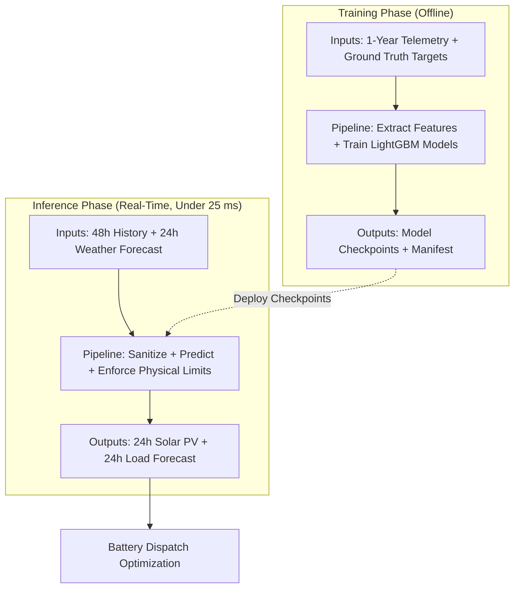
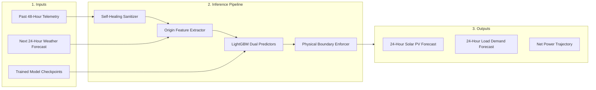

# Helios Model Pipeline: Simple Technical Flowcharts

This document provides concise flowcharts for presentation slides.
The language follows the ASD-STE100 standard.
All sentences are short, active, and direct.

---

## 1. Unified Architecture (Training vs. Inference)

This single flowchart shows both phases on one slide.
The training phase builds the models.
The inference phase generates the real-time forecasts.

---

## 2. Model Training Flowchart

Use this diagram to explain how the system trains the models.

### Training Summary
- **Inputs**: 8,760 hourly records (irradiance, temperature, cloud cover, PV power, and load demand).
- **Process**: Trains two gradient-boosted tree models with 4-season cross-validation.
- **Outputs**: Serialized model files and validated accuracy scores (PV nMAE: 0.30%, Load nMAE: 3.09%).

---

## 3. Forecasting / Inference Flowchart

Use this diagram to explain how the system generates a 24-hour forecast.

### Inference Summary
- **Inputs**: 48 hours of past telemetry and 24 hours of future weather forecasts.
- **Process**: Imputes missing data, predicts power values, and forces physical rules (zero night solar).
- **Outputs**: Safe 24-hour solar and load power trajectories for battery dispatch.

---

## 4. Input and Output Comparison Table

| Phase | What Goes In (Inputs) | What Comes Out (Outputs) |
| :--- | :--- | :--- |
| **Training** | • 8,760 hourly sensor rows • Microgrid asset limits (50 kW PV, 45 kW Load) • Ground truth target values | • `pv_model.joblib` (Trained solar model) • `load_model.joblib` (Trained load model) • `manifest.json` (Quality report) |
| **Inference** | • Current origin timestamp $T$ • Past 48-hour sensor buffer • Next 24-hour weather prediction • Trained model files | • 24-hour Solar PV forecast (kW) • 24-hour Load Demand forecast (kW) • Net power vector ($P_{\text{net}} = P_{\text{pv}} - P_{\text{load}}$) • Execution latency (< 25 ms) |

---

## 5. Slide Presentation Content

### Slide 1: Training Pipeline
- **Inputs**:
  - Historical microgrid sensor data (1 year, hourly).
  - Target values: Observed PV power and facility load.
- **Core Processing**:
  - Tabular feature extraction (lags, rolling statistics, calendar indicators).
  - LightGBM regression training with cross-validation.
- **Outputs**:
  - Production model files: `pv_model.joblib` and `load_model.joblib`.
  - Quality verification: Solar nMAE = 0.30%, Load nMAE = 3.09%.

### Slide 2: Inference Pipeline
- **Inputs**:
  - Telemetry lookback: Past 48 hours.
  - Weather forecast: Next 24 hours.
  - Model checkpoints: Deployed LightGBM models.
- **Core Processing**:
  - Telemetry cleaning: Imputes short sensor gaps (<= 3 hours).
  - Feature mapping: Anchors history at origin timestamp.
  - Deterministic safety guard: Sets night solar to zero; clips power limits.
- **Outputs**:
  - 24-hour Solar PV generation curve (kW).
  - 24-hour Facility electrical load curve (kW).
  - Net power curve for battery storage dispatch.
