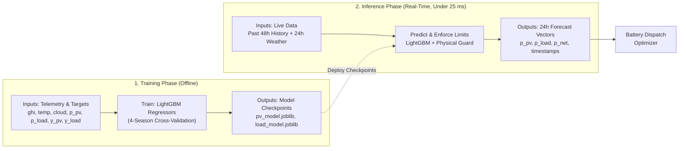
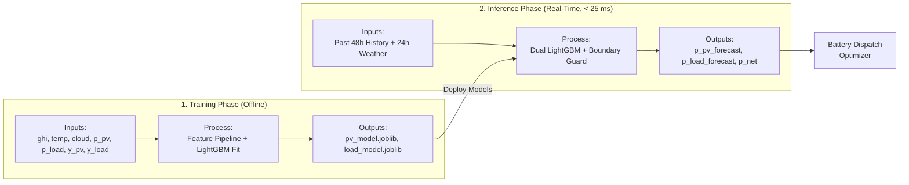
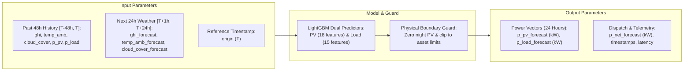
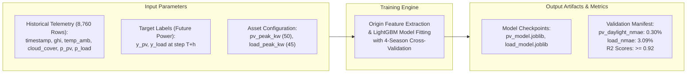

# Helios Forecasting: Slide-Ready Flowcharts (ASD-STE100)

This document provides compact flowcharts for presentation slides.
All diagrams use a horizontal layout (`flowchart LR`) to fit standard 16:9 widescreen slides.
The language follows the ASD-STE100 standard.
Sentences are short, active, and direct.

---

## Slide Option 1: Horizontal Combined Architecture (Fits 16:9 Slide)

This diagram organizes the training and inference pipelines into two clean horizontal lanes across the slide:

---

## Slide Option 1 (Alternative): Side-by-Side Column Layout

This diagram places Training on the left and Inference in the center, flowing directly to Battery Dispatch on the right:

---

## Slide Option 2: Real-Time Inference Parameters (Horizontal)

---

## Slide Option 3: Model Training Parameters (Horizontal)

